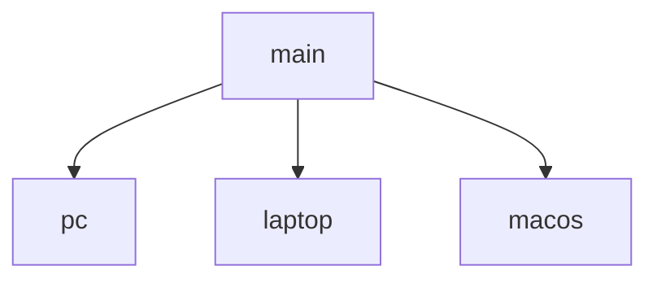

# dotfiles

Shared configuration lives on `main`; each machine has its own branch.



## Configuration

- **Terminal:** [Alacritty](https://alacritty.org/)
- **Shell:** [Fish](https://fishshell.com/)
- **Terminal multiplexer:** [tmux](https://github.com/tmux/tmux)
- **Text editor:** [Neovim](https://neovim.io/)
  - Language support: nvim-treesitter, nvim-lspconfig, blink.cmp, and conform.nvim
  - Navigation: fzf-lua, yazi.nvim, and vim-tmux-navigator
  - Git: gitsigns.nvim, diffview.nvim, vim-fugitive, and git-conflict.nvim
  - UI: rose-pine, lualine.nvim, and which-key.nvim
- **File explorer:** [Yazi](https://yazi-rs.github.io/)
- **Linux desktop:** [niri](https://github.com/YaLTeR/niri) + [Noctalia](https://github.com/noctalia-dev/noctalia-shell)
- **macOS desktop:** yabai + skhd + SketchyBar
- **Coding agent:** [Pi](https://github.com/earendil-works/pi)

## Pi subagent routing

Keep the frontier parent on design, implementation, analysis scripts, and final acceptance. Delegate only when authorized, using fresh context and compact, independently verifiable tasks.

- **DGX Qwen** (`dgx/nvidia/Qwen3.8-Flash-Next-FP4-Local`): first choice when configured and reachable; keep its endpoint configuration local.
- **OpenCode Go**: otherwise use DeepSeek v4.1 Flash (`opencode-go/deepseek-v4.1-flash`) for scouting, extraction, data analysis, research, and review, or Qwen 3.8 Flash (`opencode-go/qwen3.8-flash`) for prepared runner jobs, not open-ended coding. Select the model explicitly for each launch; the shared settings default remains DeepSeek.
- **Luna** (`openai-codex/gpt-6-luna` when available): explicit fallback for tasks the low-cost tier cannot handle. Report failed launches before retrying or switching; OpenRouter is not required.

These replace Gemini 3.8 Flash as the preferred low-cost subagent tier. Routing instructions live in `pi/.pi/agent/APPEND_SYSTEM.md`; defaults and role overrides live in `pi/.pi/agent/settings.json`.

Use the DCTwin α_rec/EC pattern: the parent prepares and checks the runner and analysis code, then asynchronous runners execute independent lanes with exact commands, isolated output paths, expected artifacts, and exit-status checks. Permit only explicitly scoped surgical fixes; escalate design changes. Default to at most three lanes, with larger fanouts explicitly budgeted and no overlapping source writers. The parent verifies artifacts and synthesizes results.

## Setup

Check out the branch for the current machine.

### Linux (`pc` / `laptop`)

Configurations are [GNU Stow](https://www.gnu.org/software/stow/) packages:

```sh
stow alacritty niri nvim tmux fish noctalia mcp yazi
mkdir -p ~/.pi/agent
stow --no-folding pi
```

Rerun `stow -R <package>` to relink a package.

### macOS

```sh
git switch macos
./install-macos.sh
```

Rerun `install-macos.sh` to relink the configuration. Existing files are moved to timestamped backups before linking.
