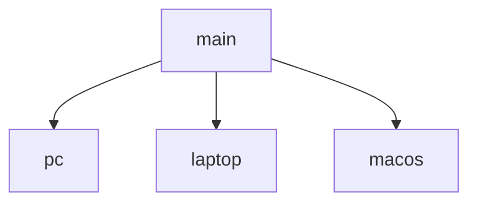

# dotfiles

Shared configuration lives on `main`; each machine has its own branch.



## Configuration

- **Terminal:** [Alacritty](https://alacritty.org/)
- **Shell:** [Fish](https://fishshell.com/)
- **Terminal multiplexer:** [tmux](https://github.com/tmux/tmux)
- **Text editor:** [Neovim](https://neovim.io/)
  - Language support: nvim-treesitter, nvim-lspconfig, blink.cmp, and conform.nvim
  - Navigation: fzf-lua, yazi.nvim, and vim-tmux-navigator
  - Git: gitsigns.nvim, diffview.nvim, vim-fugitive, and git-conflict.nvim
  - UI: rose-pine, lualine.nvim, and which-key.nvim
- **File explorer:** [Yazi](https://yazi-rs.github.io/)
- **Linux desktop:** [niri](https://github.com/YaLTeR/niri) + [Noctalia](https://github.com/noctalia-dev/noctalia-shell)
- **macOS desktop:** yabai + skhd + SketchyBar
- **Coding agent:** [Pi](https://github.com/earendil-works/pi)

## Pi subagent routing

Keep the frontier parent on design, implementation, analysis scripts, and final acceptance. Delegate only when authorized, using fresh context and compact, independently verifiable tasks.

- **Haiku** (`opencode-go/claude-haiku-5-5`): default for prepared runner jobs and explicitly scoped small changes, not open-ended coding.
- **Terra** (`openai-codex/gpt-6.1-terra`): longer-horizon tasks, scouting, research, analysis, and review.

Select the model explicitly for each launch. Qwen and DeepSeek remain available for manual experimentation. Report failed launches before retrying or switching; OpenRouter is not required. Routing instructions live in `pi/.pi/agent/APPEND_SYSTEM.md`; defaults and role overrides live in `pi/.pi/agent/settings.json`.

The parent prepares and checks the runner and analysis code, then asynchronous runners execute independent lanes with exact commands, isolated output paths, expected artifacts, and exit-status checks. Permit only explicitly scoped surgical fixes; escalate design changes. Default to at most three lanes, with larger fanouts explicitly budgeted and no overlapping source writers. The parent verifies artifacts and synthesizes results.

## Durable execution

The [durable phase runner](pi/.pi/agent/scripts/durable-loop/README.md) executes approved commands with SQLite recovery, per-phase quality gates, and sequential or isolated parallel scheduling. It resumes existing work instead of blindly replaying commands after interruption. The shared `APPEND_SYSTEM.md` defines ownership and acceptance rules.

## Setup

Check out the branch for the current machine.

### Nunc

Nunc replaces Smart Compact. Its local package must be built on each machine before starting Pi:

```sh
git clone https://github.com/tefx/pi-nunc.git ~/.pi/agent/local-packages/pi-nunc
cd ~/.pi/agent/local-packages/pi-nunc
git checkout 53310dc
npm ci --ignore-scripts --no-audit --no-fund
npm run build
```

Use `/nunc details` in Pi to check that it loaded. The separate compact-transcript package changes display, not context compaction.

### Linux (`pc` / `laptop`)

Configurations are [GNU Stow](https://www.gnu.org/software/stow/) packages:

```sh
stow alacritty niri nvim tmux fish noctalia mcp yazi
mkdir -p ~/.pi/agent
stow --no-folding pi
```

Rerun `stow -R <package>` to relink a package.

### macOS

```sh
git switch macos
./install-macos.sh
```

Rerun `install-macos.sh` to relink the configuration. Existing files are moved to timestamped backups before linking.
