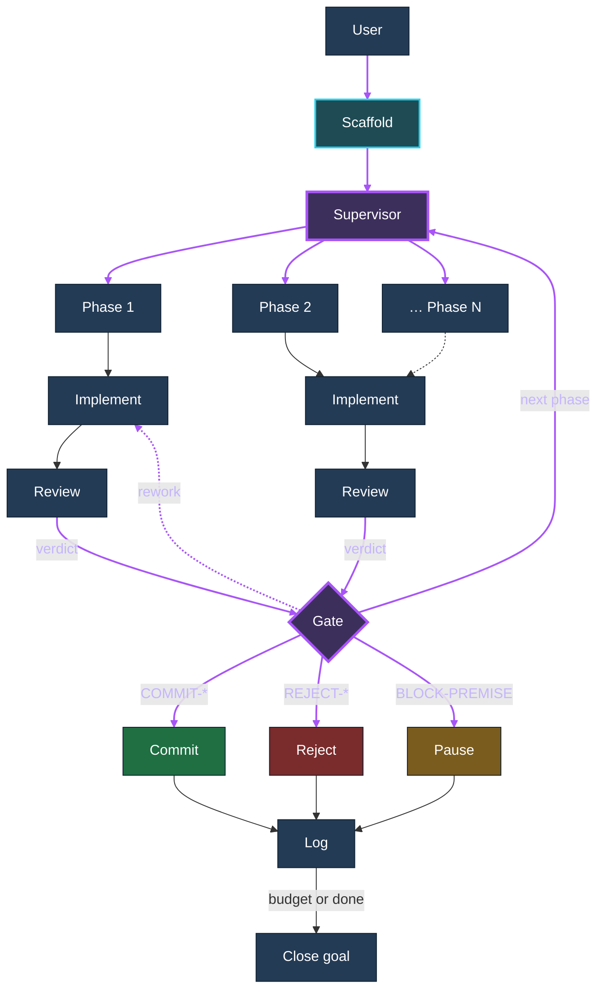
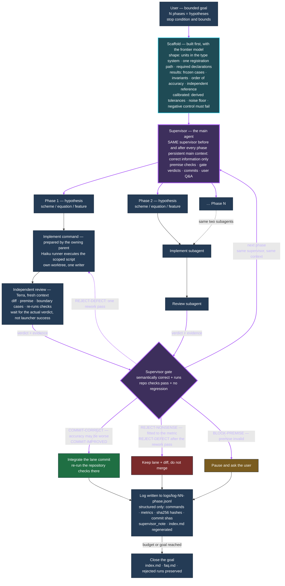
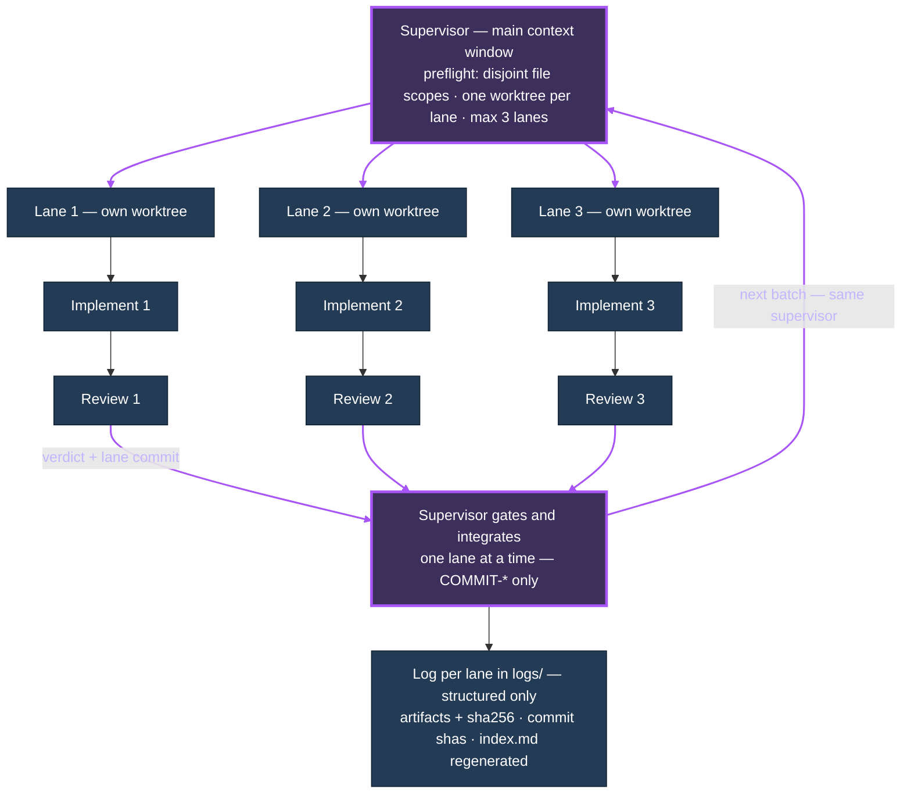
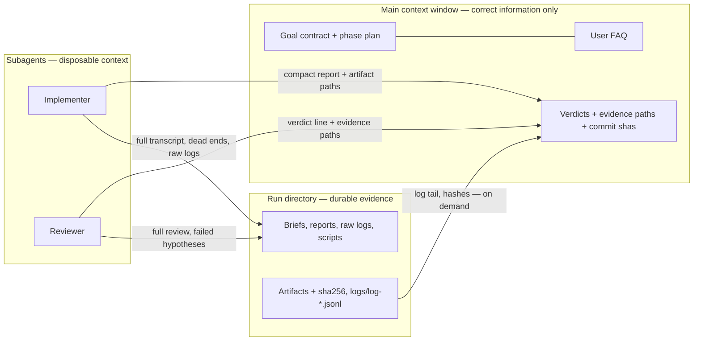
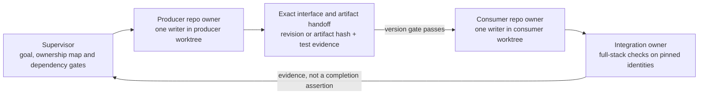
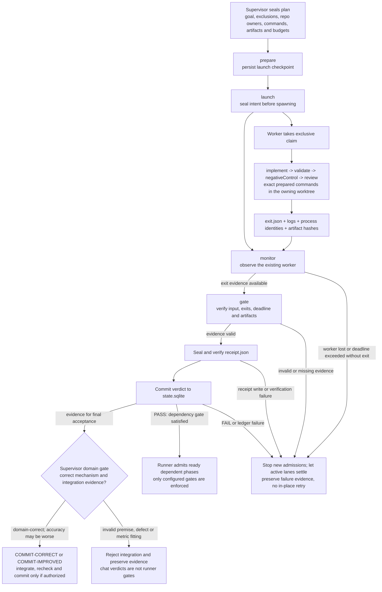
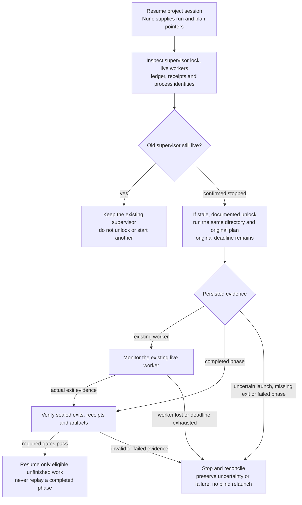

# The loop, visually

The scaffold in one sentence: a supervisor in the main context window works a bounded
goal through **N phases**; each phase is one hypothesis implemented by an **implement
subagent** and independently checked by a **review subagent**; the supervisor gates the
result and commits when the phase is *semantically* right, whatever the numbers say.

Mermaid source — renders in GitHub, your nvim Markdown preview, or any Mermaid renderer.
Sections 1–4 show the supervisory model; the final section adds the actual checkpointed
execution, repository ownership and recovery contract. Shared `APPEND_SYSTEM.md` governs
model routing and parent/runner ownership.

## 1. Overview — node headings only

The same shape as the detailed diagram below, with nothing written inside the boxes.



## 2. The scaffold: supervisor first, then N phases of implement + review

The supervisor node is **the same agent in the same context window before, between and after
every phase** — the loop returns to it. The log entry is the phase's durable record, not
a new actor, so the back-edge goes straight from the gate to the supervisor and the logs
hang off the side.



Purple marks the supervisor and every edge the supervisor owns: the scaffold handoff, the
phase dispatch, the review verdicts coming back, the rework pass, and the loop-back to the
*same* supervisor. The implement/review chain and the logs stay neutral. Each phase writes
`logs/log-NN-<phase>.jsonl`, and `index.md` states per log whether it failed or succeeded and
why.

Two phases are drawn to show the repetition; `Phase N` is the same shape. `COMMIT-CORRECT`
exists for the QUICK case — a real scheme whose numbers may be worse than central
differencing. `REJECT-NONSENSE` exists for the `q = m·ΔT` case — numbers that only come
from fitting.

## 3. Parallel independent phases

Only when the phases do not depend on each other: same supervisor, same two subagents per
phase, but N lanes at once, each in its own worktree.



Two writers never share a worktree, and only the supervisor merges.

## 4. Where information is allowed to live



Rot stays in the subagents and on disk, so a long loop does not slowly fill the main window
with wrong intermediate beliefs.

## Verdicts at a glance

| Verdict | Meaning | Lands? |
| --- | --- | --- |
| `COMMIT-CORRECT` | real mechanism, correct, runs, repo checks pass, no regression; accuracy may be worse | yes |
| `COMMIT-IMPROVED` | the same, and the frozen-case metric improves | yes |
| `REJECT-NONSENSE` | only "works" by fitting the metric, harness, case or a tuned constant | no |
| `REJECT-DEFECT` | right idea, broken/incomplete/regressing implementation; one rework pass allowed | no |
| `BLOCK-PREMISE` | the premise itself is invalid or cannot be stated | paused for the user |

Details: `references/domain-gate.md` (gates and the nonsense test),
`references/orchestration.md` (lanes and integration), `references/evidence.md` (logs and
hashing), `references/roles.md` (roles, routing, briefs).

## 5. Durable execution — repo ownership, checkpoints and recovery

For an authorized multi-phase loop, use `~/.pi/agent/scripts/durable-loop/runner.mjs`.
The supervisor prepares the bounded, immutable plan and exact commands first. Haiku
executes prepared work; Terra provides independent review. The negative-control command
succeeds only after proving the validator rejects a known-bad variant. Neither a
successful agent launch nor a passing metric establishes a review verdict or a correct
mechanism.

### Declare which repository owns each change

Before launch, write the exact ownership map in the approved goal/briefs. Replace the
example repo labels below with absolute repository/worktree paths and named owners.
Each `phase.cwd` must be the owning worktree. Keep the commands, allowed paths,
exclusions, prerequisite versions and evidence paths in that phase's contract; do not
expect the runner or a child to infer them from conversation history.

| Scope | Writer and authority | Required handoff |
| --- | --- | --- |
| Producer/library repo | Its owning parent prepares source changes; one writer in its worktree. Other repo agents are read-only there. | Interface contract, reproducer, exact source revision or built artifact identity, and validation evidence. |
| Consumer/application repo | Its owning parent changes the consumer only, after the producer version gate passes. | Pin the verified producer identity; run consumer tests against it, not a stale local build. |
| Integration worktree | One explicitly named owner; the supervisor owns final acceptance and authorized integration/commits. | End-to-end checks of the actual stack and remaining acceptance criteria. Producer tests alone are insufficient. |



Express phase ordering with `dependsOn`: the default is sequential; independent
worktrees may run concurrently, at most three phases. A dependent phase may start when
its own prerequisites pass without waiting for unrelated lanes. The supervisor separately
reserves shared ports, databases, containers and mutable artifacts. Worktree overlap
checks apply within one run; they do not coordinate other sessions or run directories.

### Execute commands through the persisted state machine



A durable `PASS` establishes the configured command/evidence checks, not scientific
truth or automatic commit permission. The review command must wait for the actual
independent verdict and fail on unresolved required findings. The supervisor still
rejects metric fitting and preserves domain-correct features even if accuracy does not
improve. Phase JSONL reports and `index.md` explain the result; they do not replace the
SQLite execution ledger and sealed receipts. The scheduler admits dependent work after
a durable `PASS`; it does not wait for a later chat verdict. If parent acceptance is
required before that work, encode it in an enforced review or prerequisite phase command.
`dependsOn` alone proves neither domain correctness nor that a consumer loaded the right
producer artifact.

Launch only the approved plan, using absolute paths:

```sh
node "$HOME/.pi/agent/scripts/durable-loop/runner.mjs" run \
  /absolute/private/run-dir /absolute/approved-plan.json
```

### Recover the same run after interruption or compaction

Nunc retains the goal, remaining acceptance conditions, exact run/plan/worktree paths,
artifact identities and last observed status. That status is a dated observation, not
permission to repeat work. After resuming the supervisor, inspect the live workers,
ledger, receipts and recorded process identities before acting.



If the old supervisor is confirmed stopped and its lock remains, use the documented
`unlock` command, then `run` with the **same run directory and original plan**. Existing
workers may survive the supervisor; the scheduler advances only while running. Keep a
long-lived supervisor under a terminal or service manager when unattended operation is
required. Downtime still counts against the persisted deadline.

Missing exits, uncertain launches, failed receipts or failed phases never authorize a
blind relaunch. Preserve the failed run and use a separately authorized, budgeted
correction plan/run instead of clearing markers or editing sealed artifacts. The
conceptual one-rework allowance above is not permission to retry a failed durable phase
in place. Resuming chat does not restart commands, reset deadlines or extend authority.

Implementation and full recovery contract:
[`durable-loop/README.md`](../../../scripts/durable-loop/README.md).
