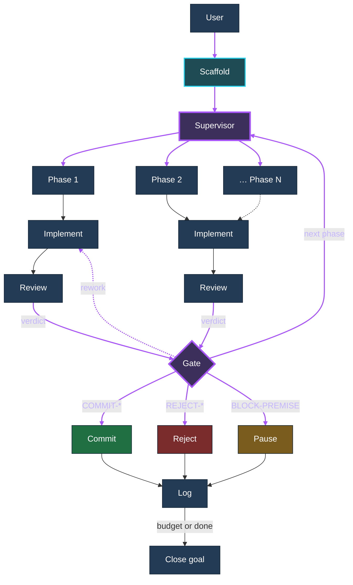
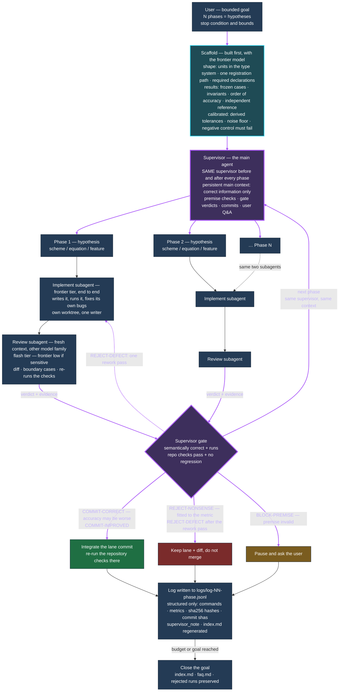
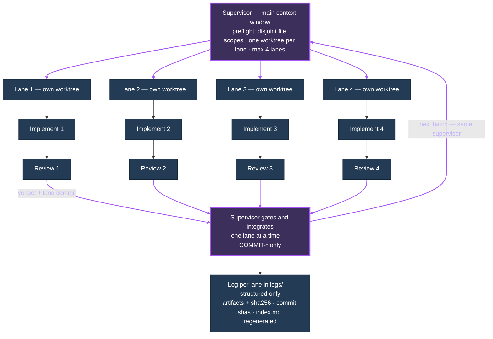
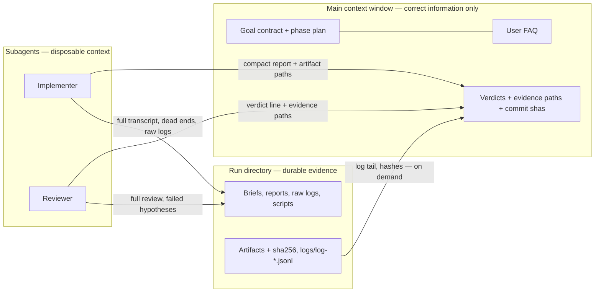

# The loop, visually

The scaffold in one sentence: a supervisor in the main context window works a bounded
goal through **N phases**; each phase is one hypothesis implemented by an **implement
subagent** and independently checked by a **review subagent**; the supervisor gates the
result and commits when the phase is *semantically* right, whatever the numbers say.

Mermaid source — renders in GitHub, your nvim Markdown preview, or any Mermaid renderer.

## 1. Overview — node headings only

The same shape as the detailed diagram below, with nothing written inside the boxes.

## 2. The scaffold: supervisor first, then N phases of implement + review

The supervisor node is **the same agent in the same context window before, between and after
every phase** — the loop returns to it. The log entry is the phase's durable record, not
a new actor, so the back-edge goes straight from the gate to the supervisor and the logs
hang off the side.

Purple marks the supervisor and every edge the supervisor owns: the scaffold handoff, the
phase dispatch, the review verdicts coming back, the rework pass, and the loop-back to the
*same* supervisor. The implement/review chain and the logs stay neutral. Each phase writes
`logs/log-NN-<phase>.jsonl`, and `index.md` states per log whether it failed or succeeded and
why.

Two phases are drawn to show the repetition; `Phase N` is the same shape. `COMMIT-CORRECT`
exists for the QUICK case — a real scheme whose numbers may be worse than central
differencing. `REJECT-NONSENSE` exists for the `q = m·ΔT` case — numbers that only come
from fitting.

## 3. Parallel independent phases

Only when the phases do not depend on each other: same supervisor, same two subagents per
phase, but N lanes at once, each in its own worktree.

Two writers never share a worktree, and only the supervisor merges.

## 4. Where information is allowed to live

Rot stays in the subagents and on disk, so a long loop does not slowly fill the main window
with wrong intermediate beliefs.

## Verdicts at a glance

| Verdict | Meaning | Lands? |
| --- | --- | --- |
| `COMMIT-CORRECT` | real mechanism, correct, runs, repo checks pass, no regression; accuracy may be worse | yes |
| `COMMIT-IMPROVED` | the same, and the frozen-case metric improves | yes |
| `REJECT-NONSENSE` | only "works" by fitting the metric, harness, case or a tuned constant | no |
| `REJECT-DEFECT` | right idea, broken/incomplete/regressing implementation; one rework pass allowed | no |
| `BLOCK-PREMISE` | the premise itself is invalid or cannot be stated | paused for the user |

Details: `references/domain-gate.md` (gates and the nonsense test),
`references/orchestration.md` (lanes and integration), `references/evidence.md` (logs and
hashing), `references/roles.md` (roles, routing, briefs).
